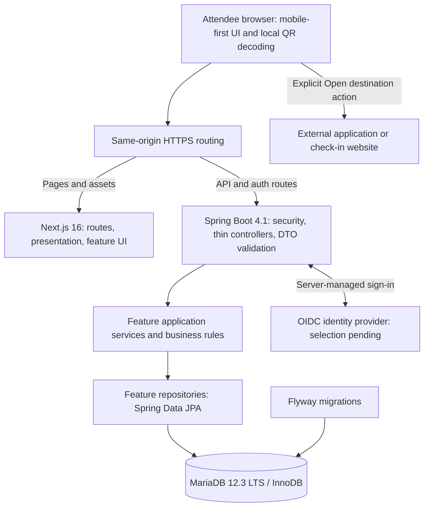

# Architecture

Status: proposed design. The repository has documentation only; the components below do not exist yet. Decisions: [ADR 0001](decisions/0001-modular-monolith.md) and [ADR 0002](decisions/0002-mariadb-selection.md).

## System boundary

Use one Next.js web application, one Spring Boot modular monolith, and one MariaDB database. The backend is a single application with feature modules, not independently deployed services. The web application remains a separate runtime for rendering and browser interaction.



The browser uses relative `/api/v1` requests. A deployment ingress or development proxy routes those and Spring Security auth paths to Spring Boot; other routes go to Next.js. Hosting and proxy implementation are unresolved. This topology avoids credentialed cross-origin browser APIs. Next.js must not query MariaDB or independently implement business endpoints.

## Responsibilities and module boundaries

| Feature | Owns |
| --- | --- |
| Identity | Mapping OIDC issuer/subject to an account; security principal and session lifecycle |
| Events | Event metadata and the event ownership check used by other modules |
| Companies | Event-specific company entries and attendee-reported booth check-in |
| Links | Labeled URL validation/storage and optional same-company opportunity reference |
| Contacts | Event-level and company-associated recruiter/networking contacts |
| Opportunities | Opportunity details and independent application state |
| Notes | Plain-text event/company notes |
| Follow-ups | Event/company tasks, due times, completion and reopening |

Use feature packages with a small public application interface. Keep repositories and entity internals inside their feature; cross-feature work calls an application service or narrow read interface, not another feature's repository. Dependencies should flow from child features toward Events for ownership and toward Companies/Opportunities for reference validation. Identity does not depend on business features. Avoid cycles and a catch-all shared business service.

Use ordinary Java package boundaries initially; additional module enforcement tooling is optional if the codebase needs it. Do not add an event bus, message broker, Redis, service discovery, or distributed transactions for the MVP.

## Request and data flow

1. Spring Security establishes the principal and enforces session/CSRF requirements.
2. A controller binds explicit DTOs and runs structural validation. It delegates to an application service.
3. The service verifies event ownership and referenced-record scope, applies business rules, and defines the transaction boundary.
4. Repositories persist entities with database constraints and optimistic locking. Responses map to DTOs; persistence objects never become API payloads.
5. Central exception handling produces consistent problem responses, including security filter errors for API paths. The frontend maps those to actionable presentation states.

Next.js route files compose feature screens. UI components manage presentation and transient drafts; feature API clients coordinate requests. Reusable controls come from shadcn/ui and Tailwind CSS 4. Client validation improves feedback, while backend validation remains authoritative. Shared URL policy examples should be used as fixtures on both sides to catch parser differences.

Private event data is fetched by the authenticated browser initially, avoiding session forwarding through server rendering. Authenticated API responses use `Cache-Control: no-store`; do not place private data in shared Next.js caches or static output. Introducing server-rendered private data later requires an explicit cookie-forwarding and caching design.

## Planned repository organization

Only create these paths when implementation needs them; this is a plan, not the current tree.

```text
frontend/src/app/                         thin Next.js routes and layouts
frontend/src/features/<feature>/          feature UI, API clients, validation, tests
frontend/src/components/ui/               reusable presentation controls
backend/src/main/java/com/boothbridge/
  <feature>/                             api, application, domain, persistence as needed
  shared/                                small technical error/security utilities
backend/src/main/resources/db/migration/  versioned Flyway migrations
backend/src/test/                         unit and integration tests by feature
frontend/e2e/                            Playwright user journeys
.github/workflows/                       CI once build commands exist
docs/                                    requirements, contracts, decisions
```

Avoid empty layers or an interface for every class. A small feature may initially need only a controller/DTO, service, entity, and repository within its package.

## Persistence and transactions

- One relational schema, with feature-owned tables. Foreign keys may cross feature boundaries to protect integrity; Java module boundaries still restrict direct repository access.
- A write service transaction covers authorization-sensitive reads, reference validation, and the write. A company and opportunity must belong to the same event as a saved link.
- Flyway is the schema authority. Use Hibernate schema validation, never schema auto-update for managed environments.
- Use optimistic versions and conditional writes to prevent lost updates; define errors in [API contracts](api-contracts.md). Parent deletion is restricted while dependents exist, avoiding hidden cascading loss.
- Database transactions never span browser navigation, OIDC calls, QR camera interaction, or arbitrary URL requests. The backend does not fetch scanned destinations.

## Authentication and operations

Use provider-managed OIDC sign-in and a Spring-managed, opaque session cookie on the same origin. Spring Boot owns the security boundary; see [security.md](security.md). Start with one backend instance and in-memory sessions; restarts require sign-in again. Multiple backend replicas require a documented shared-session or routing design before use.

GitHub Actions should eventually run the checks in [testing-strategy.md](testing-strategy.md). Deployment automation, hosting, backups, restore procedures, runtime observability, and production settings are planned work, not configured infrastructure. Start operational logging with correlation IDs, outcome codes, and timings, excluding record contents and URLs.

## Tradeoffs and unresolved choices

- A modular monolith keeps transactions and local reasoning simple, but shared runtime and schema changes can affect all features. Revisit service extraction only for measured needs.
- Next.js plus Spring requires two runtimes and an API contract. A Next.js-only backend would reduce initial operations but depart from the chosen Java backend and concentrate persistence rules in the web runtime.
- Event-specific company entries avoid global catalog reconciliation and accidental data sharing; company details repeat across events. A shared catalog can be added later through an ADR.
- Application state is stored on each opportunity. Separate application attempts, pipeline histories, and multiple owners per opportunity are deferred until required.
- Provider selection, hosting, Java build tool, exact dependency versions, QR decoder, performance targets, and public-launch data lifecycle policies remain unresolved. AI integration requires its own privacy and architecture review after MVP validation.
