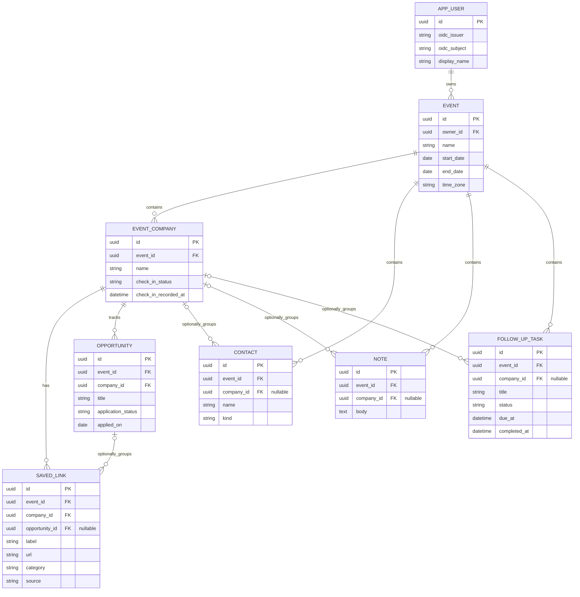

# Database design

Status: proposed logical design, not an existing schema or migration. Use MariaDB 12.3 LTS with InnoDB; see [ADR 0002](decisions/0002-mariadb-selection.md).

## Ownership and modeling rules

- An account owns many events. Every business record belongs to exactly one event, directly or through its company; authorization always resolves to the event owner.
- `event_company` represents an attendee's company entry at a particular event. There is no global company catalog or sharing in the MVP. Identical company names across events or within an event are allowed.
- A company has many saved links, contacts, opportunities, notes, and tasks. Contacts, notes, and tasks may instead belong directly to the event without a company.
- Each opportunity is one privately tracked posting/application attempt with its own application status. No separate application table is needed for this MVP. A company booth check-in is a different field with different meaning.
- A saved link always belongs to a company and may additionally refer to one opportunity at that company. Company-wide links can be used for several opportunities without creating a join table.
- Notes and tasks attach to an event or company, not directly to a contact or opportunity in this version. Direct associations can be added if validated by usage.

## Conceptual ERD

The diagram omits common audit fields and the direct event relationships for links/opportunities for readability. Those tables still carry `event_id` for enforced scope, as described below. Optional foreign keys do not permit cross-event references.

## Columns and value conventions

All tables have a server-generated UUID `id`, `created_at`, `updated_at`, and a numeric `version` starting at zero for optimistic locking. Use `CHAR(36)` with an ASCII binary collation for UUIDs initially; binary UUID storage is a possible later optimization. Use `utf8mb4` for user text, UTC `DATETIME(6)` for instants, and `DATE` for event/application calendar dates. Set database connections to UTC; store the event's IANA time zone separately.

| Table | Additional columns and constraints |
| --- | --- |
| `app_user` | `oidc_issuer VARCHAR(255)` and `oidc_subject VARCHAR(255)`, both required and compared case-sensitively; unique together. Optional `display_name VARCHAR(120)`. No password or provider token columns. |
| `event` | Required `owner_id`, `name VARCHAR(120)`, `start_date`, `end_date`, `time_zone VARCHAR(64)`; optional `location VARCHAR(160)`. End date must be on or after start date. |
| `event_company` | Required `event_id`, `name VARCHAR(120)`, `check_in_status VARCHAR(24)` default `NOT_CHECKED_IN`; optional `booth_location VARCHAR(80)`, `check_in_recorded_at`. |
| `saved_link` | Required `event_id`, `company_id`, `label VARCHAR(120)`, `url VARCHAR(2048)`, `category VARCHAR(24)`, `source VARCHAR(16)`; optional `opportunity_id`. URL contains the validated canonical HTTPS destination. No uniqueness constraint on URL. |
| `contact` | Required `event_id`, `name VARCHAR(120)`, `kind VARCHAR(24)`; optional `company_id`, `role VARCHAR(120)`, `email VARCHAR(254)`, `phone VARCHAR(40)`. Store phone as display text, not a numeric value. |
| `opportunity` | Required `event_id`, `company_id`, `title VARCHAR(160)`, `application_status VARCHAR(24)` default `NOT_APPLIED`; optional `location VARCHAR(160)`, `applied_on`. Duplicate titles/postings are allowed. |
| `note` | Required `event_id`, `body TEXT` limited to 10,000 characters; optional `company_id`. Plain text only. |
| `follow_up_task` | Required `event_id`, `title VARCHAR(160)`, `status VARCHAR(16)` default `OPEN`; optional `company_id`, `due_at`, `completed_at`. |

### Controlled values and invariants

Store enum values as strings with database check constraints, not ordinal numbers. These values are also the API values.

| Field | Values | Rules |
| --- | --- | --- |
| Company check-in | `NOT_CHECKED_IN`, `CHECKED_IN` | Marking checked in sets the server's current UTC `check_in_recorded_at`; repeating the same state preserves it. Undoing clears it. |
| Opportunity application | `NOT_APPLIED`, `APPLIED`, `INTERVIEWING`, `OFFER`, `ACCEPTED`, `REJECTED`, `WITHDRAWN` | Attendee may select any state to correct history. `NOT_APPLIED` requires a null `applied_on`; other states allow a user-supplied date or null. Never infer an application date from link activity. |
| Link category | `APPLICATION`, `CHECK_IN`, `CAREERS`, `OTHER` | Descriptive only; it changes no workflow status. |
| Link source | `QR`, `MANUAL` | Informational, not proof of provenance or trust. |
| Contact kind | `RECRUITER`, `NETWORKING`, `OTHER` | No account or email address is required for a contact. |
| Task status | `OPEN`, `COMPLETED` | Completing sets `completed_at` to the server's current UTC time; repeating preserves it; reopening clears it. |

Enforce nonblank required text and declared limits at the API/service layer. Use database `NOT NULL`, foreign keys, enum checks, date-order checks, and status/timestamp consistency checks as a second line of protection. URL parsing, IANA zone validation, and ownership checks remain application responsibilities.

## Reference integrity and deletion

- `event.owner_id` references `app_user.id`. Every other business table references its event. Required parent references cannot be moved after creation; changing an event or a link/opportunity's company requires recreating the record.
- Add `UNIQUE(id, event_id)` to `event_company`. Child `(company_id, event_id)` foreign keys enforce that company and event match; a null company on a contact, note, or task retains its direct event reference.
- Add `UNIQUE(id, company_id, event_id)` to `opportunity`. A saved link's optional `(opportunity_id, company_id, event_id)` foreign key enforces a same-company opportunity. Its required company foreign key still applies when opportunity is null.
- Optional company references on contacts/notes/tasks may be changed or cleared within the same owned event. A link's optional opportunity reference may be changed or cleared within its fixed company.
- Use restrictive foreign keys: no cascading record deletion. Event/company deletion returns a dependency conflict until children are deleted or optional associations are cleared. Delete or unlink referencing links before deleting an opportunity.
- Leaf deletion is a hard delete after explicit UI confirmation. No soft deletion, automatic contact deduplication, application history, or account-wide cascade is implied. Account removal and retention policy must be designed before public launch.

## Indexes and migrations

- Index `event(owner_id, created_at, id)` for owned event lists.
- Index company/link/contact/opportunity/note/task lists by `(event_id, created_at, id)` and company-scoped lists by `(company_id, created_at, id)` where relevant. Create the composite indexes required by the scoped foreign keys explicitly.
- Add `(event_id, status, due_at, id)` for task filtering and `(event_id, application_status, created_at, id)` for opportunity filtering. Validate plans with realistic data before adding further indexes.
- Unique OIDC issuer/subject pairs identify an account; display names and email addresses do not. Do not automatically merge identities by email.
- Flyway migrations must create constraints and indexes explicitly, be immutable once applied, and run against a blank MariaDB instance in integration tests. Use JPA schema validation afterward. Pin the test database to the selected runtime release and exercise its actual transaction behavior.
- No SQL migration, sample database, backup process, or restore test exists yet. Before production, implement tested backups and recovery, separate migration/runtime privileges, and a deployment migration procedure.
